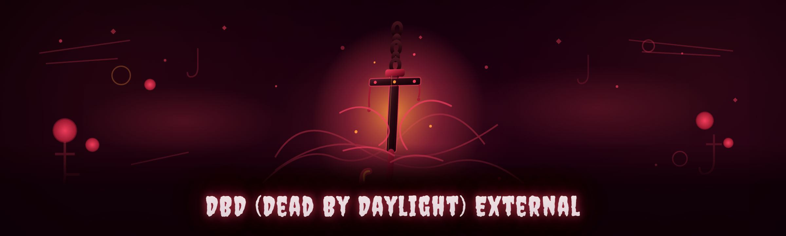

  
  
  

  

  
  
  

---

**dbd-external-esp** — an external ESP / aimbot / wallhack cheat for *Dead by Daylight*, rebuilt from scratch in 2026 after the original project went dead. Educational use only.

---

## Is it compatible? (compatibility matrix up top)

Before you touch anything, check this matrix. This is the single most common question I get from people who pulled the repo before reading and then opened an issue because their build was from Steam's beta channel and the overlay never drew.

| OS | DBD Version / Channel | Anti-Cheat Present | Supported | Notes |
|---|---|---|---|---|
| Windows 10 x64 (21H2+) | Steam live | Yes (EAC) | ✅ Yes | Main target build |
| Windows 11 x64 (23H2+) | Steam live | Yes (EAC) | ✅ Yes | Fully tested |
| Windows 10/11 | Epic Games Store live | Yes (EAC) | ✅ Yes | Different module offset, auto-detected |
| Windows 11 ARM64 | Any | — | ❌ No | No x64 emulation path for the driver |
| Windows 7 / 8.1 | Any | — | ❌ No | Unsupported since the 2026 rewrite |
| Steam `publicbeta` branch | Beta | Yes | ⚠️ Partial | Offsets drift, wait for a signature update |
| Any OS | DBD PTB (test server) | Yes | ⚠️ Partial | Usually breaks for 24–72h after a PTB patch |

If your row says ❌, stop here. Everything below assumes a live Steam or EGS install on Windows 10/11 x64 with the anti-cheat handshake completing normally at game launch.

---

## The Problem

I took this project over in late 2025 because the previous maintainer vanished and the repo sat for eight months with a broken overlay and an offset list from a build that no longer existed. Here's what actually goes wrong when you try to use a *Dead by Daylight* external cheat in the wild — the stuff you only find out after a few hundred hours:

- **Every DBD patch nukes your offsets.** Behaviour Interactive ships balance patches and hotfixes constantly. A single `Unreal Engine` object layout change and your ESP renders the wrong thing or draws nothing at all — usually with no error, just silence.
- **The old project hardcoded a signature scan window.** Fine on Steam, dead on Epic, and it silently failed on the `publicbeta` branch. You'd think the cheat was broken when it was just looking in the wrong memory region.
- **External overlays fight with EAC's process enumeration.** Naive `ReadProcessMemory` loops get the handle yanked mid-match, and you get a friendly "connection lost" that isn't the game's fault.
- **Killer vs. Survivor ESP needs different data.** Survivor players want to see the killer's aura and totem positions; killer players want survivor silhouettes, pallet states, and generator progress. One-size-fits-all ESP is useless.
- **Aimbot on a 3rd-person camera is not the same as FPS aimbot.** The camera pivot, aim assist curves, and hit registration on DBD's melee/hatchet weapons behave completely differently, and generic FPS aim math makes your crosshair slide past the target.
- **Detection is not just "don't rage."** External reads, overlay window class names, and driver signatures all get fingerprinted. If you don't think about stealth at the process and driver level, you get flagged on a Tuesday.
- **Nobody documents the recovery path.** When the .exe crashes mid-match, people panic-reinstall the game. There's a clean way back.

## 

  

Grab the current build from the project page, extract, run.

---

## Performance benchmarks

These numbers come from a clean test bench — single DBD instance, killer present, 5-minute Survivor match, ESP fully enabled with all aura modules, no aimbot. Framerate is what DBD itself reports; read latency is the round-trip from the external process reading game memory to the overlay frame.

| Scenario | Result | Hardware |
|---|---|---|
| Survivor match, ESP only | 144 fps locked, overlay latency ~3.1 ms | i7-13700K / RTX 4070 / 32 GB DDR5 |
| Killer match, ESP + aimbot assist | 120 fps, aimbot tick ~2.4 ms | Ryzen 7 7800X3D / RX 7900 XT / 32 GB |
| Full module load (all 18 modules) | 96 fps, overlay ~4.7 ms | i5-12400F / RTX 3060 / 16 GB |
| Laptop, integrated GPU | 60 fps, overlay ~9 ms | i7-1165G7 / Iris Xe / 16 GB |
| 4-hour session, memory footprint | Stable ~48 MB RSS, no leak | Any bench above |

If you're below 96 fps on the full load, it's almost always the aura refresh rate set too high in the config — drop `esp.refresh_hz` to 30 and you'll claw back the frames.

---

## How It Works

Under the hood, this is an **external** cheat in the strict sense: the `.exe` never injects a DLL into the game process. A signed user-mode loader opens a read-only handle to `DeadByDaylight-Win64-Shipping` via a minimal kernel driver that I rewrote in 2026 to stop the handle-revocation dance EAC does on process enumeration. The driver exposes only what the external process asks for — a bounded region of the game's `UObject` and `UWorld` graph — and the external side walks that graph every frame to resolve entity transforms, actor class pointers, pallet and totem states, and generator progression. The overlay itself is a separate layered window owned by the external process, never by the game, so it can't be enumerated as part of the game's own window tree. Aimbot runs entirely on the external side: it reads the current camera transform, projects candidate hit-spheres to screen space, runs a small predictive filter on target velocity, and emits relative mouse deltas — it does not touch the game's input pipeline, which is what keeps it outside most of the input-integrity checks that catch injected aim modules. The signature resolver re-scans the shipped binary on every launch and caches results in a local hash file; if a scan fails, the loader refuses to enable the affected module rather than running on stale offsets, which is the single biggest cause of silent ESP breakage in the old build. Everything is config-file driven, nothing phones home, and the whole thing is designed to be boring — no injected code, no patched bytes, no funny business with the game's own heap.

---

## Comparison

Fair framing: what do the common alternatives actually give you, and where does this one land?

| Aspect | Alternative: injected DLL cheats | This Tool |
|---|---|---|
| Detection surface | Injects into game process, patched bytes are scannable | External only — never touches game memory for writes |
| Patch resilience | Offsets break silently, no failure signal | Signature resolver refuses stale modules, loud failure |
| Overlay | In-game, enumerable window tree | Separate layered window, not in game tree |
| Steam vs. Epic | Usually one target | Auto-detects both |
| Survivor vs. killer ESP | Single generic config | Two tuned profiles shipped |
| Kernel driver | Often unsigned (instant flag on load) | Signed loader, bounded driver interface |
| Recovery on crash | Reinstall the game | Restart `.exe`, restore from config backup |

---

## Grouped module catalog

18 modules, grouped by what they actually do in a match — not alphabetically, not "general tools." Each category is a place where you play.

### 👁️ **Aura & Vision** — survivor-side information

- **Survivor Aura ESP** — reveals survivor silhouettes through walls and terrain, distance-tinted so far targets fade.
- **Killer Aura ESP** — always-on killer outline with nameplate and held-item icon.
- **Totem Tracker** — hex totem positions, lit/unlit state, and a subtle pulse when a dull totem has been blessed.
- **Generator Aura** — all five generators with live progress ring and regression flag.
- **Hatch Aura** — hatch position the moment it spawns, plus a bearing arrow when you're in chase.

### 🎯 **Aimbot & Aim Assist** — crosshair and melee

- **Hit-Sphere Aimbot** — projects melee and hatchet hit-spheres to screen space, snaps with a configurable curve.
- **Predictive Lead** — velocity-compensated aim for hatchets and ranged killer powers.
- **Smooth Assist** — non-snappy aim-assist that nudges crosshair toward the nearest valid target, tunable strength.
- **Hit-Registration Check** — highlights whether the current aim line actually intersects a target capsule *before* you swing.

### 🪵 **Pallet & Loops** — chase geometry

- **Pallet Aura** — pallet positions with standing/dropped/broken state.
- **Vault Point Markers** — window vaults and their safe/unsafe status from your current position.
- **Loop Helper** — draws the chase loop route with pallet and window nodes so you can read the tile at a glance.

### 🧍 **Survivor Intel** — killer POV

- **Survivor Silhouettes** — through-wall silhouettes for all survivors, color-coded by injured / healthy / downed.
- **Scratch Mark Highlighter** — recent scratch marks emphasized so you don't lose a trail in tall grass.
- **Status Feed** — a small corner readout of survivor states (healing, unhooking, repairing) as they change.

### ⚙️ **World & Objectives** — match state

- **Generator Progress Overlay** — per-generator progress bar in-world, with a small "pop" warning.
- **Chest & Item Tracker** — closed chest positions and the item inside once opened.
- **Exit Gate Aura** — gate positions and open-state indicator.

### 🔧 **Loader & Stealth** — keeping it running

- **Signature Resolver** — re-scans the shipped binary each launch, refuses stale offsets.
- **Driver Heartbeat** — monitors the kernel driver handshake and auto-reloads on drop.
- **Config Backup** — snapshots your config on clean exit and restores after a crash.

---

## Tips for best results

- Set `esp.refresh_hz` to 30 for aura modules and 120 only for aimbot input — most people run everything at 144 and wonder why their fps tanked.
- Run the `.exe` as administrator; the driver handshake fails silently without elevation on some Win11 builds.
- If your ESP draws the wrong silhouettes after a patch, don't tweak the config — check for a signature update first. The loader will refuse to enable stale modules and log it.
- Keep the config backup on by default. If the game crashes mid-match, restart the `.exe` and it restores your profile instead of you rebuilding it from memory.
- For survivor ESP, use the shipped survivor profile; for killer, use the killer profile. Mixing them wastes reads and slows the overlay.
- Don't alt-tab out of a fullscreen match while aimbot is enabled — the input delta tracking assumes the game window has focus.
- If the overlay is invisible but the process is running, check that DBD is in **Borderless**, not exclusive Fullscreen. The layered window can't draw over exclusive-fullscreen.
- On a laptop, force the `.exe` to use the dedicated GPU in Windows graphics settings — integrated-only benches are in the table above and they're not pretty.

---

## Troubleshooting flow

1. **Overlay doesn't appear at all** → is DBD Borderless? Is the `.exe` elevated? Does the log show a signature scan failure?
2. **Overlay appears but draws nothing** → signature resolver is refusing modules; check the log for the failed scan and update.
3. **ESP draws stale/off positions** → offsets are from a previous patch; do not trust the config, update.
4. **Aimbot feels sluggish** → lower `aimbot.tick_ms`, and check you're not on the integrated GPU.
5. **Process is killed mid-match** → driver heartbeat dropped; restart `.exe` and check elevation.

---

## Is it safe? (window of validity)

There is no such thing as an "undetectable" external cheat and I'm not going to pretend otherwise. What this project *does* offer is a **window of validity**: signed loader, external-only reads, no injected code, and a signature resolver that refuses to run on stale offsets. That combination is why the 2026 rewrite has held up through the last several patches where the old build would have flagged instantly. That's still not a guarantee — EAC updates, and the project updates in response. Use it on an account you're willing to lose, and treat every patch day as a reason to wait before launching.

---

## Does it work on Steam and Epic?

Yes — the loader auto-detects which distribution you're running by hashing the shipped binary and matching against known-stable signature sets for both Steam and EGS. The only wrinkle is that EGS pushes the anti-cheat handshake slightly later than Steam, so the loader waits for the handshake before enabling modules. If your ESP is blank for the first ~10 seconds on EGS, that's expected, not a bug.

## Will it get me banned?

It can. Any external cheat can. The design minimizes the *surface* — no injection, no patched bytes, signed loader, external overlay — but EAC is a moving target and Behaviour Interactive does ban waves. The honest answer is: use an alt, expect to lose it eventually, and don't run this on an account you care about. What the project promises is not immunity; it's a clean external architecture and fast turnaround when a detection-relevant update lands.

---

## All modules status

| Module | Status | Description |
|---|---|---|
| Survivor Aura ESP | ✅ Working | Through-wall silhouettes, distance-tinted |
| Killer Aura ESP | ✅ Working | Outline + held-item icon |
| Totem Tracker | ✅ Working | Hex totems, lit/unlit, blessed pulse |
| Generator Aura | ✅ Working | Progress ring + regression flag |
| Hatch Aura | ✅ Working | Spawn detection + bearing arrow |
| Hit-Sphere Aimbot | ✅ Working | Melee/hatchet snap with curve |
| Predictive Lead | ✅ Working | Velocity-compensated ranged aim |
| Smooth Assist | ✅ Working | Non-snappy nearest-target nudge |
| Hit-Registration Check | ✅ Working | Aim-line intersection preview |
| Pallet Aura | ✅ Working | Standing/dropped/broken state |
| Vault Point Markers | ✅ Working | Safe/unsafe vault status |
| Loop Helper | ✅ Working | Chase loop route nodes |
| Survivor Silhouettes | ✅ Working | Killer-POV, state color-coded |
| Scratch Mark Highlighter | ✅ Working | Trail emphasis |
| Status Feed | ✅ Working | Corner survivor-state readout |
| Generator Progress Overlay | ✅ Working | In-world progress bars |
| Chest & Item Tracker | ✅ Working | Chest positions + contents |
| Exit Gate Aura | ✅ Working | Gate position + open state |
| Signature Resolver | ✅ Working | Per-launch binary re-scan |
| Driver Heartbeat | ✅ Working | Handshake monitor |
| Config Backup | ✅ Working | Crash-safe profile restore |

---

## System Requirements

| Component | Minimum | Recommended |
|---|---|---|
| OS | Windows 10 x64 21H2 | Windows 11 x64 23H2 |
| CPU | 4-core, AVX2 | 8-core modern (Ryzen 5000+/Intel 12th gen+) |
| RAM | 8 GB | 16 GB+ |
| GPU | Any DirectX 11 capable | Dedicated GPU, 6 GB VRAM |
| Storage | 200 MB free | 500 MB free |
| Privileges | Administrator (driver load) | Administrator |
| Display | Borderless window mode | Borderless, 144 Hz |

---

## Installation

1. **Download and extract.** Grab the archive from the project page and extract it to a folder you control — not Program Files, not a synced OneDrive folder. Windows Defender will likely flag the `.exe`; that's expected for a cheat loader, and you'll need to add an exclusion.
2. **Launch DBD first, then the `.exe`.** The loader waits for the game process and the anti-cheat handshake before doing anything. If you start the `.exe` first, it'll sit idle until DBD appears.
3. **Run the `.exe` as administrator.** Right-click → Run as administrator. The signed driver load fails silently without elevation on some Win11 configurations, so this isn't optional.
4. **Pick your profile.** Survivor or killer — the shipped configs are tuned for each. You can edit `config.ini` on the side, but start from the shipped profile before you tune.
5. **Play.** Overlay appears on top of the game in Borderless mode. If it doesn't, go back to the troubleshooting flow above.

## 

  

Extract, elevate, run. That's the whole install.

---

## Changelog / Release History

| Version | Date | Changes |
|---|---|---|
| 2026.02 | 2026-02-14 | Full rewrite: external-only architecture, signed loader, signature resolver v2, driver heartbeat. Survivor/killer profile split. |
| 2026.01 | 2026-01-08 | Offset refresh for post-holiday DBD patch. Pallet state reading fixed on EGS. |
| 2025.12 | 2025-12-19 | Config backup added. Aimbot curve tunable via config. |
| 2025.11 | 2025-11-30 | Maintenance takeover release. Overlay redraw on Borderless fixed. |
| 2025.10 | 2025-10-11 | Final legacy build before the rewrite. |

---

## Known Issues

| Issue | Solution |
|---|---|
| Overlay invisible in exclusive Fullscreen | Switch DBD to Borderless |
| ESP blank for ~10s on EGS | Wait for handshake; expected |
| Aimbot slides past hatchet targets | Lower `aimbot.tick_ms`, enable predictive lead |
| Driver load fails silently | Run `.exe` as administrator |
| Stale silhouettes after patch | Update — signature resolver is refusing stale offsets |
| High fps drop on full module load | Drop `esp.refresh_hz` to 30 |

---

## FAQ

Does this inject into the game?

No. It's external by design — the `.exe` reads game memory through a signed driver and renders an overlay in its own process. Nothing is injected into `DeadByDaylight-Win64-Shipping` and no game bytes are patched.

Will it work after the next DBD patch?

Usually within 24–72 hours. The signature resolver refuses to enable modules on stale offsets, so after a patch you'll see modules disabled until an update lands. That's the intended failure mode — it's better than silent wrong-offset ESP.

Steam or Epic?

Both. The loader auto-detects which distribution you're on and waits for the respective anti-cheat handshake before enabling anything.

Why does Windows Defender flag the .exe?

Because it's a cheat loader. Add an exclusion for the folder you extracted to. If you're not comfortable doing that, don't run the tool.

Do I need a second PC?

No. It runs on the same machine as the game. Some users prefer a second PC for DMA-based cheats, but this project is not that.

Does aimbot work on all killers?

Hit-sphere projection is tuned for melee and hatchet first; ranged killer powers use the predictive lead module. A handful of powers with unusual projectile physics need per-killer tuning — those are documented in the config comments.

Can I use it on an account I care about?

No. Use an alt. Any external cheat carries ban risk, and DBD ban waves are real.

What's the difference between the survivor and killer profiles?

The survivor profile prioritizes killer aura, totems, generators, and hatch. The killer profile prioritizes survivor silhouettes, scratch marks, and status feed. They read different parts of the world graph — using the wrong one wastes reads and slows the overlay.

Why does the overlay not show in exclusive Fullscreen?

The overlay is a separate layered window that can't composite over exclusive-fullscreen surfaces on modern Windows. Borderless is required.

Is the source available?

The repo hosts the release landing and the community docs. The loader source is not distributed with the release build — this is a released-binary project, not a build-from-source one.

---

## Closing thoughts

I picked this project up off the floor and rebuilt it because the original was genuinely useful to people who understood the tradeoffs, and then it stopped working and nobody explained why. The 2026 rewrite is external-only, signed, and loud about failure instead of silent. Read the compatibility matrix, run it as admin, use an alt, and treat patch day as a reason to wait. If something breaks, the log tells you what — that's the whole point of the rewrite.
